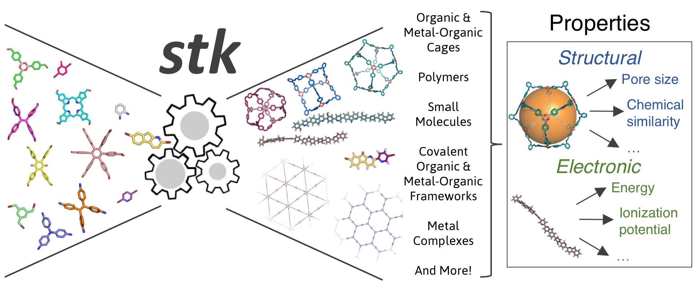

:maintainers:
  `lukasturcani <https://github.com/lukasturcani/>`_,
  `andrewtarzia <https://github.com/andrewtarzia/>`_
:documentation: https://stk-lite.readthedocs.io
:discord: https://discord.gg/zbCUzuxe2B

.. image:: https://github.com/lukasturcani/stk/actions/workflows/tests.yml/badge.svg?branch=master
  :target: https://github.com/lukasturcani/stk/actions?query=branch%3Amaster

.. image:: https://readthedocs.org/projects/stk-lite/badge/?version=latest
  :target: https://stk-lite.readthedocs.io

Overview
========

``stk-lite`` is a light-weight version of `stk`_ with mostly the same
functionality.

.. _`stk`: https://stk-lite.readthedocs.io

``stk`` is a Python library which allows construction and
manipulation of complex molecules, as well as automatic
molecular design, and the creation of molecular, and molecular
property, databases. The documentation of ``stk`` is available on
https://stk.readthedocs.io and the project's Discord server can be
joined through https://discord.gg/zbCUzuxe2B.

Installation
============

To get ``stk-lite``, you can install it with pip:

.. code-block:: bash

  pip install stk-lite

If you would like to get updated when a new release of ``stk`` comes
out, which happens pretty regularly, click on the ``watch`` button on
the top right corner of the GitHub page. Then select ``Releases only``
from the dropdown menu.

You can see the latest releases here:

  https://github.com/TarziaResearchGroup/stk-lite/releases

There will be a corresponding release on ``pip`` for each release
on GitHub, and you can update your ``stk`` with:

.. code-block:: bash

  pip install stk-lite --upgrade

Warning:

  SMILES strings generated with ``stk`` version ``v2025.07.17.0`` or sooner
  (using ``rdkit`` version ``2024.9.1`` or sooner) will be different than newer
  versions due to a change in handling the valence of organic atoms bound to
  metals. Details can be found in the ``rdkit`` release notes `2025_03_1`_.
  No changes occur in ``stk`` construction. An example change in SMILES:
  ``CCCO->[Fe+2]`` becomes ``CCC[OH]->[Fe+2]``.

.. _`2025_03_1`: https://github.com/rdkit/rdkit/releases/tag/Release_2025_03_1

Developer Setup
---------------

1. Install `just`_.
2. Install `uv`_.
3. In the source directory, run:

.. code-block:: bash

  just setup

3. Run code checks:

.. code-block:: bash

  just check

.. _`just`: https://github.com/casey/just
.. _`uv`: https://docs.astral.sh

How To Cite
===========

If you use ``stk`` or ``stk-lite`` please cite

  https://github.com/lukasturcani/stk

and

  https://aip.scitation.org/doi/10.1063/5.0049708

Acknowledgements
================

I began developing this code when I was working in the Jelfs group,
http://www.jelfs-group.org/, whose members often provide me with
very valuable feedback, which I gratefully acknowledge.
