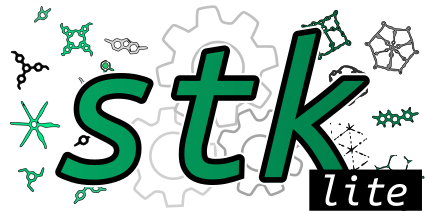

.. stk documentation master file, created by
   sphinx-quickstart on Mon Nov 13 11:15:04 2017.
   You can adapt this file completely to your liking, but it should at least
   contain the root `toctree` directive.

.. toctree::
   :hidden:
   :caption: stk
   :maxdepth: 2

   Construction Overview <construction_overview>
   Basic Examples <basic_examples>
   Video Tutorials <video_tutorials>

.. toctree::
   :hidden:
   :caption: Molecules
   :maxdepth: 2

   Building Block <_autosummary/stk.BuildingBlock>
   Constructed Molecule <_autosummary/stk.ConstructedMolecule>
   Functional Groups <functional_groups>
   Functional Group Factories <functional_group_factories>
   Key Makers <key_makers>
   Reactions <reactions>
   Reaction Factories <reaction_factories>
   Writers <writers>

.. toctree::
   :hidden:
   :caption: Topology Graphs
   :maxdepth: 2

   Topology Graph Components <graph_components>
   Polymers <polymer>
   Small Molecules <small>
   Organic & Metal-Organic Cages <cage>
   Covalent Organic Frameworks <cof>
   Metal Complexes <metal_complex>
   Host Guest Complex <host_guest>
   Macrocycle <_autosummary/stk.macrocycle.Macrocycle>
   [n]Rotaxane <_autosummary/stk.rotaxane.NRotaxane>
   Adding Topology Graphs <_autosummary/stk.TopologyGraph>
   Optimizers <optimizers>

.. toctree::
   :hidden:
   :caption: Modules
   :maxdepth: 1

   Modules <modules.rst>

.. tip::

  ⭐ Star us on `GitHub <https://www.github.com/lukasturcani/stk>`_! ⭐

============
Introduction
============

| GitHub: https://www.github.com/TarziaResearchGroup/stk-lite
| Discord: https://discord.gg/zbCUzuxe2B

``stk-lite`` is a light-weight version of `stk`_ with mostly the same
functionality.

.. _`stk`: https://stk-lite.readthedocs.io

Installation
------------

To get :mod:`.stk`, you can install it with pip::

  $ pip install stk-lite

Developer Setup
...............

#. Install `just`_.
#. Install `uv`_.
#. In the source directory, run::

    $ just setup

#. Run code checks::

    $ just check

.. _`just`: https://github.com/casey/just
.. _`uv`: https://docs.astral.sh

Overview
--------

:mod:`stk` is a Python library which allows construction and
manipulation of complex molecules, as well as automatic
molecular design, and the creation of molecular, and molecular property,
databases.

Molecular Construction
......................

:mod:`.stk` provides tools for constructing a variety of molecular
structures, including organic and metal-organic cages,
covalent organic frameworks, polymers and metal complexes, to name a
few. While additional molecular
structures are always being added, :mod:`stk` provides tools which
allow users to easily specify new kinds of molecular structures,
no matter how simple or complex, in case something they want to build
is not built-in. :mod:`stk` also makes it easy to specify which isomer
of a given structure should be built.

Here is a preview of some of the more complex structures
:mod:`stk` can construct

.. image:: https://i.imgur.com/PvkfoGs.jpg

Automatic Molecular Design
..........................

:mod:`.stk` provides an evolutionary algorithm, which can be used for
discovery of new molecules, which have properties desired by the user.
This evolutionary algorithm works with any molecule :mod:`stk` can
construct, even those defined by users.

Usable Defaults
...............

A goal of :mod:`.stk` is to provide simple interfaces and require
minimal information from users to achieve basic and common tasks,
but also allow extensive customization and extension in
order to fulfill complex requirements.

Extensibility and Customization
...............................

Every part of :mod:`.stk` can be extended and customized in user
code, and every user-made extension is indistinguishable from
natively implemented features. This means users can use
:mod:`.stk` to construct new classes of molecules, add new
kinds of molecular databases, and add or customize evolutionary
algorithm operations, all
without looking at :mod:`.stk` source code. All such extensions will
work with the rest of :mod:`.stk` as though they were part of the
library itself.

Documentation and Examples
..........................

Every use-case and extension or customization of :mod:`.stk` has
documentation and examples which will guide users.
:mod:`.stk` is built around abstract base classes, which means
all user extensions to :mod:`.stk` involve creating a new class and
defining, usually, a single method.

Future Releases
---------------

:mod:`.stk` is under active development. You can get alerted
when a new release comes out by going to the `GitHub page`_ and
click on the ``watch`` button in the top right corner. Then select
``Releases only`` from the dropdown menu.

.. _`GitHub page`: https://github.com/TarziaResearchGroup/stk-lite

Important features in the future will include:

More Molecular Structures
.........................

:mod:`.stk` is always being expanded with new molecular structures.
If there is a specific kind of molecule you would like to be able
to construct with :mod:`.stk`, and you don't feel like implementing
it yourself, simply create an issue on
https://github.com/lukasturcani/stk/issues, and describe what you would
like to build.

What Next?
----------

Something you might like to do first, is look at the
`construction overview`_, which can give you a picture of how
:mod:`stk` goes about constructing molecules. It will also introduce
you to the basic concepts and types found within :mod:`stk`. Next, the
`basic examples`_, will allow
you to get a feel for how to use :mod:`stk`. After that, examples of
molecular construction can be seen by looking at the documentation of
the different topology graphs. In general, you will find examples on
how to use a class, in that classes documentation.
Once you are comfortable with construction, you can start looking at
how to deposit and retrieve the molecules from databases. Finally,
:mod:`stk` provides multiple examples on how to use its evolutionary
algorithm.

.. _`construction overview`: construction_overview.html
.. _`basic examples`: basic_examples.html
